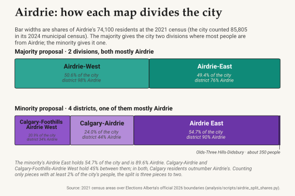

<!--
© Will Conner 2026 | CC BY-NC-SA 4.0 <https://creativecommons.org/licenses/by-nc-sa/4.0/>
Data: Elections Alberta (public domain) | https://ixby.github.io
-->
> **Backward:**
> - `reports/academic/report_academic.md` — full technical monograph this report condenses
> - `findings/population_equality.md` — population MAD numbers cited
> - `findings/partisan_bias_summary.md` — partisan-metric numbers cited
> - `findings/airdrie_overlap_report.md` — Airdrie split narrative
> - `findings/joint_outlier_score_summary.md` — Mahalanobis joint outlier
> - `findings/checklist_baseline_scoring.md` — gerrymander checklist source
> - `analysis/methodology/threshold_provenance.md` — threshold context
>
> **Forward:**
> - `README.md` — links to this as the public-audience report
> - `docs/FINDINGS_BRIEF.md` — even shorter brief derived from same findings
> - (leaf otherwise — general-audience report, public-facing)

# Two Maps, Then None: Inside Alberta's 2026 Boundary Audit

*A plain-language look at the 2025–26 Electoral Boundaries Commission, the math behind the minority map, and what comes next.*

## How to read this report

You came here looking for a smoking gun. This report does not have one. It cannot have one — and why it cannot is the most important thing the audit found.

Alberta's 2025–26 Electoral Boundaries Commission finished its work on March 23, 2026, and could not agree. Three commissioners signed one map. The other two, the two the government nominated ([Legislative Assembly notice, March 28, 2025](https://www.assembly.ab.ca/about/news-and-announcements/2025/03/28/electoral-boundaries-commission-to-soon-begin-consultations); copy at `evidence/legislature/assembly_news_ebc_appointed_2025-03-28.html`), signed a different one. Both maps meet the *Electoral Boundaries Commission Act*'s numeric rules, though the majority argued the minority's map would likely fail a Charter challenge. Three weeks later, on April 16, the government brought in Government Motion 37 (passed April 21), which set both maps aside and handed the job to a committee of six MLAs (members of the Legislative Assembly), most of them from the governing United Conservative Party (UCP). An independent advisory panel working for that committee delivered a new map on October 22. On October 28 the committee voted 3–2 to end its review, adding no observations of its own. The panel's report was due before the Assembly by November 2, 2026.

This audit measured both commission maps, and the process around them, every way it knew how. Five structural tests, written down on April 24, 2026, after a first measurement of both maps on provisional boundaries, and dated in this repository. Four partisan-fairness metrics, scored against 1,010,000 neutral maps a computer drew with no stake in who wins. Independent checks of the reasons the commissioners published. A review of the process against sixty years of Canadian practice. What it found is not a gun. It is **casings**: fourteen pieces of evidence, each one real, each one measured, each of which would count for something in a courtroom somewhere, and none of which, alone or together, can legally prove the conclusion they invite. A casing on the ground proves a gun existed and was fired. It cannot prove whose hand was on it. That gap between evidence and proof is not a loophole the audit failed to close. In Canada it is the system as written. That, too, is a finding.

So this report is built like an evidence log. Each casing faces the same five questions, in the same order, every time:

- **What we found** — the evidence, with its number.
- **What it could show** — the conclusion you will be tempted to draw, stated at full strength.
- **What the experts say** — how this kind of evidence is treated in places that do fight about it in court.
- **What Canadian practice expects** — the norm.
- **Why it isn't a smoking gun** — the specific reason, under Canadian law, this evidence proves less than it seems to.

Each of the eight legal lessons is different. By the fourteenth casing you will have learned, one piece at a time, how Canadian boundary law really works. And why every casing in this log ends the same way.

Two casings in the log point the wrong way for the audit's own story, and both are told in full: one test that does not tell the maps apart, and one test where the minority map beat the majority. A report that never loses an argument with itself isn't checking. Tests that failed, and tests that found nothing, are part of the record.

> **A NOTE ON LEGAL TERMINOLOGY**
>
> "Gerrymandering" has no legal definition in Canadian law. This report uses the word in its everyday political sense: manipulating electoral boundaries for partisan advantage. The legal tests that apply in Canada are different. Do the boundaries provide "effective representation" under s.3 of the *Charter of Rights and Freedoms*, the constitutional standard the Supreme Court of Canada set in the 1991 *Saskatchewan Reference*? And did the commission follow the rules of Alberta's *Electoral Boundaries Commission Act*? The audit's findings are evidence bearing on those legal questions. They are not proof of a legally-defined wrong, and this report does not describe them that way.

The audit measures the maps. It does not try to read the commissioners' minds, and it does not say either map breaks the law. The author has disclosed a relevant prior: he has voted for and donated to both conservative and progressive provincial parties in Alberta. For about 27 years he has also worked as a contract election officer for Elections Alberta, election by election, administering the vote on election day; nothing in this audit comes from that work. Three findings that ran against his expectation were kept in the report anyway. Anyone who runs the same scripts on the same data gets the same numbers; the audit is built that way. The code is public on GitHub. The random seeds are derived from a published value of a public randomness source (drand, run by the League of Entropy) plus a label, so anyone can reproduce them; that alone does not rule out seed choice. All the input data is public.

---

## The picture, before the proof

![The two ways of measuring the maps, plotted together. Left to right: how skewed the map looks on the partisan-fairness number. The further right, the more it favours the UCP. Bottom to top: how many of four discriminating structural tests the map fails. The higher, the worse. (Municipal anchoring was the fifth test; both maps sit close to the 2019 map's 75%, so it is not counted.) The 2019 enacted map sits in the safe corner, low on both; it fails none of the tests run on it (the Calgary zone test was never run on the 2019 map). The majority 2026 map (teal) stays flat at zero structural problems and near-zero partisan skew (+0.1%). The minority 2026 map (purple) fails **four of four discriminating tests**; its efficiency gap (+4.0%) sits just below the audit's ~4.1% outlier line.](../../data/maps/article/stakes_quadrant.svg){: .verdict-hero }

Three maps, two lanes of measurement. One dot is not like the others. This picture is the audit's whole case in one image, and right now you have no way to judge whether it means anything. The lines on it are not laws. The corner is not a courtroom. By the end of this report you will know exactly what this picture can prove, and exactly what it cannot. We come back to it there.

---

## The Map on the Cover

The cover map is the best single image in this audit. Here is how to read it.

Alberta is divided into 4,765 Voting Areas, the small zones Elections Alberta uses to count the ballots cast at polling stations. Each one is coloured by how the people in it voted in 2023: orange where NDP votes gather, blue where UCP votes gather. But the colour only turns dark and full where a lot of people live. A Voting Area that covers hundreds of square kilometres of parkland or farmland stays pale, nearly invisible. The map lights up where people are, and fades where they aren't.

This is a very different picture from the Alberta you see on election night. Most election maps paint whole ridings, the districts that each elect a member to the Legislature, solid blue or orange by who won. Rural ridings cover a lot of ground and the UCP wins most of them, so election-night Alberta looks like a wall of blue with small orange pockets in Edmonton and Calgary. The cover map uses the same votes and the same geography, but weights them by where people actually live. What appears is a province where most of the people crowd into a dense arc of cities, and those cities vote very differently from the rural map that usually stands for them.

The lines drawn over the colour are the minority commissioners' 89 proposed electoral districts, the map this audit ends up critiquing. The audit's work is to ask what those lines do to the people underneath.

This was the image that made the stakes clear. On a standard map the province looks like it votes one way. Underneath, most of its people live in areas that vote the other way. Once you can see the people under the boundary choices, those choices stop looking random.

---

## Act I: What the Map Does {.new-page}

Act I walks the lines themselves. No election results, no simulation: just geometry anyone can check against a paper map. The two drafts were drawn in the same room, by five commissioners working from the same rules in the Act, the same provincial geography, the same archive of about 1,345 public submissions, the same demographic data. They agree on most of Alberta. Where they part, they part on choices someone in the room had to make.

### Casing 1 — A city of 85,805 with one seat of its own {#casing-1}

**What we found.** The minority map splits the City of Airdrie into four pieces. Airdrie has 85,805 people (2024 municipal census), one council, one tax bill, and every civic system treats it as a unit. The law caps each electoral division at one-and-a-quarter times the provincial average, so Airdrie needs at least two divisions. The majority map gives it two. The minority gives it four: north to Olds-Three Hills-Didsbury, east to Airdrie East, west to Calgary-Foothills-Airdrie West, centre-south to Calgary-Airdrie. Airdrie East takes more than half the city, and nine in ten of its people are Airdrie residents. Nearly all the rest of the city is stapled to two Calgary-edge districts, where Calgary residents outnumber Airdrie's. The north piece holds about 350 people. The split clears the first bar of the audit's cracking test (academic report §5.3.2): more pieces than the city's size requires. It fails the second, that Airdrie's residents be outnumbered in every piece, because of Airdrie East. By the test's own rule, that is no cracking signature. The majority's two-way split fails both bars.

**What it could show.** For the part of the city outside Airdrie East, the textbook case of *cracking*: splitting a community so thinly that it decides nothing. An Airdrie resident with a question for her MLA has to know which part of the city she lives in before she can call the right office. The PTA at her child's school cannot send a single delegation to one MLA about school funding. It has to coordinate three delegations to three offices (the fourth piece holds about 350 people), and two of those MLAs answer first to voters outside Airdrie. If you wanted to dilute a fast-growing, politically contested city, this is one way it could look, though by the audit's test it is not a cracking signature.

**What the experts say.** Splitting a community is one of the main red flags in the research on redistricting, because it is one of the two mechanical moves, with packing as its mirror, by which lines turn votes into fewer seats. A four-way split is invisible to every partisan-fairness statistic except the one that asks: can a voter find their MLA?

**What Canadian practice expects.** Canadian commissions treat keeping a city or town whole as a core anchor for community of interest. Splitting a city this size in two is routine. Splitting it four ways, so nearly half its residents are a minority, is not — and the same commission's majority draft proves a two-way split was there to be drawn on the same geography.

**Why it isn't a smoking gun.** The *Electoral Boundaries Commission Act* allows municipalities to be split. Community of interest is one factor among several the Act lists, and it is not binding; the *Saskatchewan Reference* tells courts to defer to how boundary bodies weigh those factors. The audit's review found no Canadian decision that struck down a map for splitting a city. Both maps stay inside the Act's population band; the majority argued the minority map would likely fail a Charter challenge (final report, p. 10). The four-way split is a choice, and under Canadian law the choices inside the statute's wide lanes belong to the mapmaker. *(Legal lesson 1: the statute's factors are discretionary, and courts defer.)*

*A casing, not a gun.* — [Know more: Appendix A, what "cracking" actually does to a vote](#appendix-a)

### Casing 2 — The three boundaries the majority called out {#casing-2}

**What we found.** The commission's majority (the chair and two commissioners), appointed under the same Act as the minority and working from the same submissions, flagged four boundaries on the minority map as geographically anomalous. Among them are these three: the Rocky Mountain House–Banff Park extension into national-park land with few residents; the lasso-shaped corridor of Calgary-Nolan Hill–Cochrane; and the reach of Olds–Three Hills–Didsbury into north Airdrie. In the commission's official final report, the majority called the park extension "a bad faith effort" to claim a population protection written for remote communities where people actually live. The majority gave its own map zero such flags. Criticism that runs only against the other side is what you would expect, not an independent verdict between the two maps. What gives the flags weight is that the audit inspected the four named boundaries and confirmed anomalous geometry at three; a check of the majority's four Calgary hybrids, with questions built from the minority's anomalies, found none. (The fourth named boundary, Calgary-Foothills-Airdrie West, did not meet the audit's confirmation threshold; the majority's published criticism covers seven boundary configurations in total.)

**What it could show.** Three commissioners, the chair among them, watched these lines being drawn and charged in the official report that a legal protection was being gamed. That is as close to direct evidence as this record gets.

**What the experts say.** The study of bizarre shapes is where gerrymandering detection began, and corridors and empty extensions are its classic signatures. In fairness, the Banff arrangement has a defensible geography under the odd name and the odd shape. The town of Banff sits inside a federal park it cannot grow into, and grouping the townsite with Canmore has sound community-of-interest logic. [The Banff section below](#banff) tells that two-sided story in full; it credits what deserves credit, and it shows why the majority's objection stands anyway: the objection is aimed at the empty-park extension, which the townsite's placement does not touch.

**What Canadian practice expects.** Commissioners disagree in their reports all the time. A commission majority accusing colleagues of bad faith in the official final report is another matter. We know of no earlier case, but did not search every report.

**Why it isn't a smoking gun.** The majority's words are opinion, inside a report with no legal force. "Bad faith" in a commission report is an accusation, not a finding any tribunal made. No tribunal ever weighed it. Under the Act the majority's report is the commission's report (s.9), and that report is advice, nothing more. The legislature could set both maps aside. It did. *(Legal lesson 2: commission reports bind no one — the legislature holds the pen.)*

*An accusation in the official record — a casing, not a gun.* — [Know more: Appendix B, shape analysis and what s.15(2) protection is for](#appendix-b)

### Casing 3 — One zone of Calgary, drawn too big {#casing-3}

**What we found.** The same zone of Calgary, drawn by the same commission under the same constraints, comes out about 8.5% larger on one map than on the other. In 17 districts across north, east and central Calgary (including the Airdrie and Cochrane hybrids), the minority map's divisions average 11.5% above the provincial average. On the majority map, 2.8%. That clears the first bar of the audit's packing test (academic report §5.3.1). It fails the second. Packing means one party's winners pile up huge margins. Replay the 2023 election-day votes on the official boundaries and the NDP wins 8 of these 17 districts, by an average of 15.0 points, against a provincial average of 27.6. That is 12.6 points *below* the average, where the test needs 15 points above (`data/outputs/packing_signature_rescore_2026-11-01.json`). So by the test's own rule there is no packing signature. What stands is a population-equality finding: these districts hold more people, so each vote in them weighs less. The test was exploratory from the start; it was written in the same commit as its first run.

**What it could show.** Oversized districts where one party's voters live are the first mark of *packing*: crowding one party's voters into fewer, larger districts so each of their ballots weighs less. Packing and *cracking* (Casing 1) are the two classic gerrymandering moves. Both shrink a party's seat count below its share of the vote. Here the second mark, lopsided wins, is missing.

**What the experts say.** Packing and cracking are the two moves the US partisan-gerrymandering cases most often describe. Oversized districts exactly where one party's voters gather: that is the pattern the detection research is built to find.

**What Canadian practice expects.** Deviations, how far a district's population strays from the provincial average, are normal inside the legal band, but Canadian commissions back them with community-of-interest reasons. For this zone, the majority report charges the minority with placing "unjustifiable emphasis on 'electors' as opposed to population in northeast Calgary (which is not contemplated by the Act)" (final report, p. 10).

**Why it isn't a smoking gun.** Every one of those districts sits inside the Act's ±25% population band, and Canadian law gives no right to sue over partisan *effect*. Section 3 of the Charter protects effective representation of citizens; it does not promise parties that votes will turn into seats in proportion, and no Canadian court has read it that way. *(Legal lesson 3: inside the band, size asymmetry is lawful discretion — partisan effect is not a recognized legal harm.)*

*Two casings now, still no gun.* — [Know more: Appendix C, packing in a three-district toy example](#appendix-c)

### Casing 4 — Worse at the one thing the law actually measures {#casing-4}

**What we found.** The minority map spreads its district populations much wider than the majority's. The commission's own population tables show it: the Population Mean Absolute Deviation (MAD), which asks how far the average district strays from its ideal share, is 4,707 on the minority map against the majority's 3,180, which is 48% wider. The audit also used a second measure on the official shapefiles, the digital boundary files: the median absolute deviation (MedAD), how far the typical district sits from the middle-sized one (3,938 vs 2,827). Against computer-drawn neutral maps that keep each new district within ±12.5% of equal, the minority's MedAD sits at the 99th percentile: only about 1 in 100 of those maps is more uneven. Against neutral maps allowed the law's full ±25%, both commission maps are more equal than almost all of them. So that percentile depends on how the neutral maps are drawn. And on 2021 census counts, in place of the commission's 2024 estimates, the two maps' average spreads come out almost the same. (Details: academic report §5.4.9 and Appendix C.)

**What it could show.** Equal votes are the one value the statute puts a number on, and this map paid it away. A map that spreads people this much wider than the map drawn beside it is buying something with it, though neutral maps drawn to the law's full band spread people wider still. The common defence — "they had to draw weird boundaries to equalize population" — runs exactly backwards here: the minority map is *worse* at population equality than the majority drawn beside it.

**What the experts say.** Every formal model of redistricting treats equal population as the first constraint. A spread this wide, on a map drawn at the same time as a tighter one, is a cost signal: evidence that other goals outranked the statute's central value.

**What Canadian practice expects.** Canadian commissions treat the deviation band as a limit, not a budget.

**Why it isn't a smoking gun.** The ±25% band is the *only* limit the statute sets on how far an ordinary district's population may stray, and no district on either map crosses it. The law does not rank maps inside the band: a 99th-percentile spread and a median spread are, legally, the same. *(Legal lesson 4: the statute sets exactly one limit on population spread, and this map complies with it.)*

*Three casings now, still no gun.* — [Know more: Appendix D, what MAD measures and why the band exists](#appendix-d)

### Casing 5 — Municipal anchoring: both maps near the 2019 map {#casing-5}

**What we found.** *Anchoring* is the fraction of an electoral border that lies on a pre-existing administrative line: a city limit, a school-division boundary, a Statistics Canada census line. The majority map anchors at 80% and the minority at 72%. The 2019 map, drawn by the last commission, anchors at 75% on the same measure. This test does not separate the two maps.

**What it could show.** When a district boundary follows a city or town line, the property-tax line, the school-division line and the provincial-election line all match, and voters can tell where their district begins and ends. On that measure the two maps look alike.

**What Canadian practice expects.** Nothing. No Canadian statute or practice guide requires any particular anchoring rate. The 2019 map's 75% describes what the last commission did; it does not prescribe anything.

**Why it isn't a smoking gun.** It settles nothing either way. Both maps sit close to the 2019 map, and the Act sets no anchoring threshold.

### Act I in one picture

The same tests as a table, with the summary in the bottom row:

| Test | Majority map | Minority map | Direction / Beneficiary |
|---|---|---|---|
| Border follows existing municipal lines (2019 map: 75%) | 80% | 72% | N/A — both close to the 2019 map |
| Population spread (tighter is better) | 3,180 | **4,707 — 48% wider** | Structural (Reduces vote equality) |
| NE/central Calgary population excess above average | 2.8% | **11.5%** | Structural (Reduces vote equality; no packing signature, Casing 3) |
| Boundaries flagged by the commission's majority | 0 | **4** (3 confirmed by the audit) | N/A |
| Airdrie split (constraint minimum: 2) | 2 pieces | **4 by territory; 3 by people (≥2%)** | **UCP** (Splits urban/suburban voters; no formal cracking signature, Casing 1) |
| **Summary** (≥ 4 of 5) | **0 of 5 fired** | **4 of 5 fired** (anchoring test neutral — both maps close to the 2019 map's 75%; remaining 4 tests all fire) | **UCP** |

On Act I's tests, the majority crosses zero discriminating structural thresholds. The minority crosses every discriminating one: four of four, with the fifth, which does not tell the maps apart, shown, not hidden. These measurements are geometric; they do not depend on any statistical sampler or on any vote attribution. They show how the minority map differs from the majority map, not how far it sits from neutral: most legal maps drawn at random by computer would cross them too, because both commission maps follow municipal lines and balance populations more tightly than random maps do (`findings/structural_lane_calibration_2026-10-31.md`). The audit wrote all five down on April 24, 2026, after it had measured both maps on provisional boundaries, and added the 4-of-5 rule the next day; both came before the final simulation results were compiled. They are dated in this repository, not registered at OSF.

---

## Act II: What the Simulation Sees {.new-page}

Act I needed nothing but the lines. Act II asks a harder question: how unusual are these maps, next to what a process with no agenda would draw? To answer it, the audit had a computer draw 1,010,000 Alberta maps with no stake in who wins (4 independent chains × 252,500 steps, base seed derived from a published value of the drand public randomness beacon run by the League of Entropy). It drew them from the same 4,765 voting areas, keeping each new district within ±12.5% of equal (the Act allows ±25%) and every district in one piece; the official Elections Alberta shapefiles place the two commission maps among them. Think of the simulation as a "what-if machine": what would Alberta's maps look like if nobody was trying to do anything? Set a real map among them and its percentile, the share of neutral maps it outscores, tells you how far out into the tail it sits. A note on seat counts: the 2026 commission maps each have **89** districts; the simulation's neutral maps have **87**, the 2019 map's count; the panel's new map has **91**. All percentages are seat *shares*, which puts the three sizes on one scale, though not perfectly. A size-matched check (October 30, provisional) finds the same tilt; a size-matched joint number has not reported.

One fact about Alberta makes every number below readable. In this province, neutral is not 50/50. Across the 1,010,000 neutral maps, the median map, the middle of the pile, gives the UCP only 44.8% of seats when the province-wide vote splits exactly even. The reason is geography: rural UCP voters win their ridings by wide 60-40 margins, wasting many "extra" votes, while urban NDP voters win theirs by tighter 51-49 margins and waste fewer. Left alone, Alberta's natural political geography mildly favours the NDP's seat efficiency. Keep that baseline in mind: it is what the maps below are measured against.

### Casing 6 — Fewer than 100 maps in 1,010,000 {#casing-6}

**What we found.** Split the vote dead even, 50/50, and ask each map how many seats it hands the UCP:

| Map | UCP seats at 50/50 votes | Where it sits |
|---|---|---|
| 2019 enacted | 46.0% | 78th percentile (65th once tied maps are counted) — inside the normal range |
| **Majority 2026** | **46.1%** | **78th percentile — well within bounds** |
| **Minority 2026** | **51.7% (46 seats)** | **99.99th percentile — fewer than 100 of 1,010,000 neutral draws reach this** |

The full neutral spread: median 44.8%, 95th percentile 48.3%, 99th percentile 49.4%, maximum 51.72%, and 69 of the 1,010,000 plans exceed the minority map's 51.69%. Neighbouring maps in the chain are near-copies, so the million are worth about 1,400 independent draws; allowing for that, the minority map sits above at least the 98th percentile. The other fairness measures repeat the story: on the mean-median gap the same map lands deeper in the tail than 99.97 per cent of the neutral maps; on declination, deeper than 98.8 per cent. All of them lean the same way, toward the UCP. What does that mean in seats? Replay the 2023 election-day vote, which leaned more UCP than the full count, and the minority map's geometry hands the UCP 60 of 89 seats. On the majority map, 55.

To measure what "aiming" can do, the audit also ran a targeted hill-climbing search in both directions, the standard tool for exploring maps that are biased but legal (Cannon et al. 2022). It took 40,000 steps each way, under the same constraints, on the same geometry:

| Procedure | Most-extreme value reached | What it tells us |
|---|---|---|
| Neutral simulation, maximum produced | 51.72% UCP seats @ 50/50 | The natural ceiling under neutral drawing |
| Neutral simulation, minimum produced | 37.9% UCP seats @ 50/50 | The natural floor under neutral drawing |
| Targeted hill-climb, UCP-maximizing | **52.9%** | What a procedure deliberately aiming for UCP advantage can reach |
| Targeted hill-climb, NDP-maximizing | **37.9%** | What deliberate aiming the other way can reach |

The minority map's 51.7% sits closer to the UCP ceiling that deliberate aiming reached (52.9%) than to the neutral median (44.8%). The majority map's 46.1% sits at the 78th percentile, inside the normal range. And around 50/50 the lopsidedness is starker than the number alone. A fine-grained sweep finds the minority map keeps the UCP at or above the 45-seat majority threshold down to about **49.2%** of the two-party vote: the UCP could lose it by about 1.6 points and still form government. On the majority map, the UCP would need to *win* it by about 9 points to reach the same threshold. Same geography, same rules. The gap between the two maps is structural, not noise.

**What it could show.** Neutral processes essentially never produce this map. The majority map is the kind of map a neutral procedure turns out all the time. The minority map is the kind you have to set out to draw.

**What the experts say.** Ensemble outlier analysis, setting a real map against a large collection (an ensemble) of neutral maps to see whether it stands out, is the state of the art in redistricting statistics. It is the method US courts found persuasive in the state cases that struck maps down. Three of four metrics in the extreme tail, and all four leaning the same way, is a strong outlier profile. And the "it's just Alberta's natural geography" defence is already answered inside the method, because the simulation runs *on* Alberta's natural geography. That geography's baseline advantage tops out where the 2019 map and the 2026 majority sit: the 78th percentile, with the 2019 map's highest placement on any partisan measure in the low 90s. The minority sits at the 99.99th percentile *against Alberta's naturally skewed baseline*.

**What Canadian practice expects.** No Canadian commission has ever been required to test its map against a neutral ensemble. Here the audit is importing a standard the process itself never had to meet. That is exactly why the result tells you something. And exactly why it binds nobody.

**Why it isn't a smoking gun.** Two reasons, one legal and one statistical. Legal: as far as this audit's review found, no Canadian court has yet weighed ensemble evidence, and in the United States the Supreme Court held in *Rucho v. Common Cause* (2019) that even strong statistical evidence of partisan gerrymandering is not for federal courts to police. A percentile is a description, not a threshold crossed. Statistical: the ensemble respects the population limits and keeps every district in a single connected piece, but it does not enforce every statutory criterion the commission worked under (s.15(2) hybrid protections, community of interest, municipal anchoring). So its percentiles measure how extreme a map is against that reference set, not against "everything a legally compliant commission might have drawn." A strong outside check; not a perfect one. One more honest limit: a real electorate is not frozen at 50/50, and a big enough swing can swamp any map's structural lean. The 50/50 test isolates what the map adds to the outcome, not the outcome itself. *(Legal lesson 5: the best evidence type in the field has no legal home in Canada.)*

*Sixty-nine of 1,010,000 — a casing, not a gun.* — [Know more: Appendix F, how the what-if machine works and how to read a percentile](#appendix-f)

### Casing 7 — The test that missed {#casing-7}

**What we found.** The fourth partisan-fairness metric is the *efficiency gap*, a single number for how lopsidedly a party's votes turn into seats. For the minority map it came in at +4.0%: the 94.5th percentile. The audit's pre-registered outlier line is the 95th percentile, about +4.1% on Alberta's simulated distribution. It missed. It leans the UCP's way, but it sits below the line, and every table in this report shows it that way. The majority map's efficiency gap is +0.1% (16.5th percentile).

**What it could show.** On its own, almost nothing. That is exactly why it is in the log.

**What the experts say.** An honest set of tests produces near-misses: a report where every test fires should make you more suspicious of the auditor than of the map. This one missed, and it stays a miss. (The efficiency gap's proposed US threshold, about 7%, is an academic proposal no court has adopted.)

**What Canadian practice expects.** Nothing. No Canadian body uses the efficiency gap at all.

**Why it isn't a smoking gun.** It isn't even claimed as one. This casing is here to show the pile was counted honestly. Pre-registration cuts both ways: the same locked line that gives the other metrics their force makes this one a miss. And a miss it stays. *(Epistemic lesson: the threshold was set before the answer was known — so the answer is allowed to be "no.")*

*A casing, not a gun — and this one the audit does not even fire.* — [Know more: Appendix G, the efficiency gap in one worked example](#appendix-g)

### Casing 8 — One in 568,000, and what that number is not {#casing-8}

**What we found.** The chance that a neutral drawing process produces the minority map's combined four-metric profile is bounded at about **one in 568,000**. That is a deliberately cautious ceiling: the audit doubled its own margin to cover the second analytical channel it examined. Why double it, and not quote the stronger single-test number? Because the audit gave itself two chances to find something rare. Two channels, two chances for luck to look like a signal, so the odds are multiplied by two before they are quoted. The doubling holds no matter how the two channels relate, and they are not independent: both read the same 2023 votes. The four measures inside the simulation count as one look, not four, because they are folded into a single joint score before any probability is worked out. (For the technical record: p ≤ 1.76×10⁻⁶, a Bonferroni-corrected, dependence-robust upper bound.) This is an exploratory result: the joint test and the doubling were not registered before the data were examined. Two limits come with it. The minority's profile lies beyond every one of the 1,010,000 neutral maps, so the number comes from a statistical model, not a count. And the neutral maps have 87 districts against the commission maps' 89. A size-matched check (October 30, provisional) finds the same tilt; a size-matched joint number has not reported.

**What it could show.** You want this number to be "the probability the map is innocent." It is the audit's strongest single number, and the pull to read it that way is enormous.

**What the experts say.** The number is well defined, and defensible as what it actually is: the probability of the *map's measured profile* arising under a *neutral drawing process*. Statistics has a name for confusing P(evidence given innocence) with P(innocence given evidence). It is the prosecutor's fallacy, and it has sent innocent people to prison. This report refuses the swap. How rare the observation is under the neutral null is not the probability of wrongdoing; for that you would need things no one has, like how often drafting is eccentric but sincere.

**What Canadian practice expects.** No Canadian legal standard uses a number like this. There is no threshold for it to cross, because the law never defined one.

**Why it isn't a smoking gun.** A one-in-568,000 map can still, in principle, come from unusual but honest judgment. The number measures how far outside neutral practice the map sits. It cannot see motive, and this report will not pretend it can. What the audit does claim is weaker, and well supported: neutral random drawing is not a plausible explanation for this profile. What *is* the explanation is a question the audit puts in your hands. *(Legal-epistemic lesson: no probability of a map is a probability of intent.)*

*One in 568,000 — a casing, not a verdict.* — [Know more: Appendix H, the prosecutor's fallacy in plain language](#appendix-h)

### Casing 9 — We tried to shoot our own result down {#casing-9}

**What we found.** The audit mounted three attacks on its own headline, with mixed results, and all of them are reported. First, the sampler swap, which changes the engine that draws the neutral maps: the tail position survives replacing the simulation's mathematical engine with a structurally different one (a spanning-forest sampler, pre-registered at OSF as registration he53s and executed 2026-07-10). Every metric's percentile moved by less than one point, a pre-registered ROBUST verdict on all four, though the run fell short of its registered effective-sample target, so shifts that small are within its own margin of error. Second, the software swap: an independent implementation (the R `redist` package) drew 5,000 plans, and none reached the minority's value; on that smaller run the majority map also sits just above the 95th percentile ([`findings/redist_python_comparison.md`](findings/redist_python_comparison.md)). Third, the mechanism test, which the audit's claim *failed*: the audit tested whether the flagged geometry of Act I (the corridors, the park extension, the splits) is the specific mechanism producing the Act II seat advantage. The answer is no. Both lanes point at the same map and lean the same way, but the claim that the geometry is the mechanism did not survive its falsification test, and the report says so.

**What it could show.** The outlier belongs to the map, not to the audit's tools.

**What the experts say.** Holding up across samplers and implementations is what separates a finding from an artifact. Publishing your own failed falsification is what separates an audit from advocacy.

**What Canadian practice expects.** Nobody requires any of this. The audit imposed it on itself, in writing, before running it.

**Why it isn't a smoking gun.** Ruling out artifacts is not ruling in design. Surviving the sampler and software swaps shows the map is genuinely, robustly extreme — it says nothing about *why*. *(Epistemic lesson: robustness strengthens the description, never the accusation.)*

*A casing, not a gun.* — [Know more: Appendix I, what a sampler is and why swapping it matters](#appendix-i)

### Casing 10 — The signals that pointed the other way {#casing-10}

**What we found.** Three entries in the log do not help the audit's story, and all are reported. **One the minority passed outright:** the neighbour-drain test looks for the classic adjacency pattern, where packed districts sit right beside districts won on thin margins. The minority shows 1 coupled chain signal against the majority's 2 (and the 2019 enacted map's 5): a genuine pre-registered PASS, the single test where the minority numerically beats the majority. Section 5.3.5 of the academic report explains why the pass is real but narrow: the minority gets its partisan effect through *hybridization*: splitting cities into districts that mix urban and rural voters inside single ridings. An adjacency test cannot see that, because the packing and cracking happen within districts, not between them. **Two the audit retired:** the Swing-Zone Allocation Test asked whether voting areas in swing zones were allocated to districts in a partisan pattern. It looked significant (p = 0.0024) until the audit corrected its null for spatial clustering. Neighbouring voting areas vote alike, which breaks the test's assumption that each area is independent. After the correction it returns p ≈ 0.19, not significant, and it was retired to exploratory status on 2026-06-13. And the Fisher combination of the two channels assumes an independence they do not have, so the audit does not use it (Casing 8).

**What it could show.** As first computed, the retired tests suggested that the specific boundary choices, not just the map as a whole, were partisan-loaded. After correction, they suggest nothing.

**What the experts say.** Spatial autocorrelation, the plain fact that neighbours vote like neighbours, is the classic way redistricting statistics fool the people who make them. Correcting for it is the method working as intended. A pass on the drain test beside tail results elsewhere is not a contradiction; it is a fingerprint: it tells you *which* mechanism this map does not use.

**What Canadian practice expects.** Not applicable. These are the audit's own instruments.

**Why it isn't a smoking gun.** Two of these were the audit's casings, not the map's, and the third points in the map's favour. They are in the log because an evidence log that records only the convenient entries is not an evidence log. *(Epistemic lesson, stated twice in this report on purpose: the null can win.)*

*Two retired, one pass for the other side. We logged them anyway.* — [Know more: Appendix J, why neighbours voting alike breaks naive statistics](#appendix-j)

---

## Act III: What People Did {.new-page}

Acts I and II measured paper. Act III reads conduct: what the people in and around the process wrote, claimed and chose. In court, evidence of conduct is usually where questions of intent get answered. Watch what happens to it here.

### Casing 11 — Six reasons, checked {#casing-11}

**What we found.** We checked six of the minority's contested redraws against public data.[^asym] Some of the reasons we checked are our reading of the minority's text, not words it wrote. The point is not that the minority made its reasons up; in most of these cases the general claim is true, and a boundary that honoured it *could have* been drawn. What the data does not reach is the *particular line the minority actually drew*. The minority defends Calgary-Nolan Hill–Cochrane on the idea that Cochrane residents "move fluidly" into Calgary; Statistics Canada's 2021 journey-to-work data shows about a third of Cochrane's workers commute somewhere in Calgary, while roughly half work within Cochrane. That is a real city-to-city tie, but one that says nothing about the Nolan Hill neighbourhood the corridor actually reaches. Airdrie's commute to Calgary (about 76 percent of its out-commuters) and its rapid growth are both real, and could have supported a new Airdrie-area seat — but neither requires splitting the city four ways. Chestermere sends 86 percent of its out-commuters to Calgary, yet shares no transit system with the specific Calgary district the minority slices part of it into. And for pairing Red Deer with Sylvan Lake, the minority says rural residents "work, go to school, and gather at community events" in the city. Public schools are separate (Sylvan Lake is in Chinook's Edge School Division, the City of Red Deer in Red Deer Public), but Red Deer Catholic Regional serves both, so the school tie is partial, not absent.

[^asym]: The majority did not publish a list of reasons for contested redraws, so the six-rationale audit cannot be applied to both sides alike. It is reported as a single flag, not as extra rows in the structural-irregularity count.

**What it could show.** Reasons that do not survive checking look like rationalizations: reasons found after the line, not before. In the two that fail, the population arithmetic pointed to a boundary the minority could have drawn. The line it drew is a different one.

**What the experts say.** Setting a stated reason against what the evidence supports is called pretext analysis, exactly how US courts probe intent in the gerrymandering cases they do hear. Reasons that fail on public data are the standard tell.

**What Canadian practice expects.** Commissions publish reasons so the public can weigh them. Reasons that don't reach the line drawn, on free, public Statistics Canada data, defeat the point of publishing them.

**Why it isn't a smoking gun.** No Canadian law requires a commissioner's reasons to survive an independent check, and a failed reason fits sloppiness as easily as pretext. Courts reviewing boundaries ask whether the outcome denies effective representation, not whether the reasoning in the file was tidy. *(Legal lesson 6: bad reasons for a lawful line are still a lawful line.)*

*Bad reasons for a lawful line — a casing, not a gun.* — [Know more: Appendix K, how to check a stated reason against public data](#appendix-k)

### Casing 12 — The commission that couldn't sign one map {#casing-12}

**What we found.** The commission split: two final reports, two incompatible 89-seat maps, filed the same day. The three-commissioner majority included the chair; the two-commissioner minority, Dr. Julian Martin and John D. Evans, KC, the commissioners the government nominated, produced the map every casing so far describes. The Legislative Assembly's appointment notice lists both as "Nominated by the President of Executive Council", and Greg Clark and Susan Samson as "Nominated by the Leader of His Majesty's Loyal Opposition" ([March 28, 2025](https://www.assembly.ab.ca/about/news-and-announcements/2025/03/28/electoral-boundaries-commission-to-soon-begin-consultations); copy at `evidence/legislature/assembly_news_ebc_appointed_2025-03-28.html`). The audit's instruments cut both ways across that divide. The majority report asserted that the minority's changes in five places (Airdrie, Cochrane, Chestermere, Red Deer and St. Albert) had **no public support** in the 1,345 submissions (final report, pp. 59 and 62). The audit searched the full archive by keyword (93.4% machine-parsed; methodology and per-configuration evidence at [`findings/submission_search_findings.md`](findings/submission_search_findings.md)) and found the majority right on three of the five and partly wrong on two, Chestermere and Red Deer, which drew some aligned submissions. Two configurations the majority attacked on other grounds, Rocky Mountain House–Banff Park and Olds–Three Hills–Didsbury, also had documented public support. The majority's blanket claim is overbroad, and the archive shows it. **That finding cuts against the majority, not the minority** — and it is in this log for exactly that reason.

The criticism ran the other way too, and the log records that as well. The minority report charges the majority with “an inclination to delete or mangle rural electoral divisions and, in effect, reduce effective rural representation” (minority report, p. 356; see also p. 287: the minority “departed from the majority where we believe the legislative direction given to the Commission and the thoughtfulness of public submissions has not been given sufficient effect”). The audit's one structural counter-test aimed at the majority so far asked whether the majority's rural districts are engineered corridors of isolation. It came back supporting the innocent, geographic explanation (exploratory; design and limits at `preregistration/t3_2_majority_rural_isolation_design.md`). The audit also counted the rural divisions themselves, the same day the charge was surfaced (exploratory; hypotheses frozen before execution; full method, names, and classifier limits at `findings/rural_division_count.md`). The direction reverses: against 2019's 31 rural-anchored divisions, the majority keeps 28, absorbing three into city-named districts, merging six into three and creating two new ones, while the minority keeps 23, absorbing seven into city-named districts and merging two more into the majority-flagged Rocky Mountain House–Banff Park. A stricter version of the classifier gives the same order (28 → 24 → 19).

Both maps thin rural representation compared with 2019, which is the true core of the charge and fits the chair's own call for added rural seats. But on the measure the accusation itself names, the minority map does more of what it accuses the majority of. The same page makes a second charge that can be measured — that the majority "decline[d] to use" the Act's ±25% flexibility in rural Alberta, a flexibility the minority insists is "not a benign allowance for errors in mapmaking" but "a deliberate instruction" — and that one holds (`findings/rural_variance_usage.md`). The majority's rural divisions average 6% below the provincial mean, with only four drawn more than 10% light; the minority's average 12% below, with eleven drawn more than 10% light. Tested together, the two charges describe two design philosophies, not one vice: more but fuller rural divisions on the majority, fewer but lighter on the minority. Both directions of every cut are in the log.

**What it could show.** A process built to reach agreement produced two answers, and the outlier map came from the government's nominees.

**What the experts say.** Who appointed whom is standard evidence when researchers ask whether an institution has been captured. It carries weight only when the instruments are applied evenly to both sides, which is why the audit's correction of the majority matters as much as its findings against the minority.

**What Canadian practice expects.** One map per commission is the norm, even when a commissioner dissents. The Act does plan for a split: when there is more than one report, the majority's is the commission's report (s.9, added in 1995). It says nothing about a majority accusing colleagues in public.

**Why it isn't a smoking gun.** Nomination is not instruction. The audit found no evidence of coordination between the government and its nominees, and none can be inferred from appointment alone. Commissioners, whoever named them, have gone their own way before. *(Epistemic lesson: provenance raises the question; it cannot answer it.)*

*A casing, not a gun.* — [Know more: Appendix L, how commissioners are appointed and what nomination does and doesn't imply](#appendix-l)

### Both sides, tested — the accusations ledger

Every accusation each side put in writing, run through the same tests, each result reported where it fell. This ledger is not a scorecard. Nothing in it gets added up: some rows land on the minority, some on the majority. The only score in this report is the five dated tests above. None of these checks was written down ahead of time the way those five were, so they carry less weight, and every number and name behind them is public.

| The accusation | Who made it | Where it landed |
| --- | --- | --- |
| Four of the minority's boundaries are geometrically anomalous | The majority (final report, pp. 62–63) | Largely confirmed — the audit's inspection confirmed three of the majority's four geometric flags; the fourth fell below threshold |
| The minority's changes in five places had "no public support" | The majority (final report, pp. 59, 62) | Overbroad — right on three of five, partly wrong on two (`findings/submission_search_findings.md`) |
| The park extension was "a bad faith effort" to claim s.15(2) protection | The majority (final report, p. 10) | Undercut — the division qualifies under s.15(2) even without the flagged extension |
| The majority "delete[s] or mangle[s] rural electoral divisions" | The minority (p. 356) | Reversed — the minority keeps fewer rural-anchored divisions (23 vs 28, against 2019's 31) and absorbs more into city-named districts (`findings/rural_division_count.md`) |
| The majority "decline[d] to use" the ±25% flexibility in rural Alberta | The minority (p. 356) | Supported — majority rural divisions average −6.0% deviation (4 below −10%); the minority's average −12.2% (11 below −10%) (`findings/rural_variance_usage.md`) |
| "Substantial and consistent testimony" for hybrids was ignored | The minority (p. 356) | Partly supported — of seven configurations searched, two had clear support, two partial, three none; the chair noted "extensive submissions" for the Bearspaw/Springbank and Lethbridge hybrids (final report, p. 67) |
| The majority's rural districts are engineered corridors of isolation | The audit's own counter-hypothesis (T3.2) | Not supported — the geographic explanation held; the majority cleared |

Neither side's accusations came through whole, and neither side's map escaped a hit. In the April 16 floor debate, no one criticized the majority report at all: the government wrapped its motion in the majority chair's own recommendation, and the opposition demanded the report's adoption (`findings/hansard_april16_motion19.md`). The written charges against the majority exist only in the minority's own pages, which is why the audit had to test them itself.

### Casing 13 — When the process might have answered, it was replaced {#casing-13}

**What we found.** The commission held hearings in sixteen communities and received 1,345 written submissions (1,147 of them on the interim proposal). On the strength of many of them (the minority report counts at least 56), it reversed its interim proposal to fold Lesser Slave Lake into a larger riding: a system visibly answering the public. Four weeks after its split reports arrived, that system was replaced. The Legislative Assembly passed Government Motion 37 (introduced April 16, passed April 21, 2026). It set both reports aside and created a Select Special Committee of six MLAs, four UCP and two NDP, chaired by UCP MLA Brandon Lunty, to oversee a new 91-seat map. An independent advisory panel drew it (two members nominated by the Premier and two by the Opposition, [chaired by retired Court of Appeal justice Brian O'Ferrall](https://www.cbc.ca/news/canada/edmonton/alberta-boundaries-panel-legislative-committee-elections-9.7187435)) and gave it to the committee on October 22. The panel itself split. The committee was not required to hold public hearings, and per [CBC's reporting](https://www.cbc.ca/news/canada/edmonton/alberta-boundaries-committee-motion-9.7172743) it would not hold hearings on the map. It held none: the panel's map stays under embargo until it is tabled, and no draft was released for public challenge. On October 28 the committee voted 3–2 to end its review, adding no observations of its own. The panel's report was due before the Assembly by November 2 (committee transcript, `evidence/legislature/ceb_transcript_2026-10-28.pdf`, pp. CEB-65, CEB-67, CEB-68, CEB-72 and CEB-73). The Assembly decides. On the floor, the government presented the takeover as loyalty to the commission: "We are adopting the recommendations from the report" (Government House Leader, Hansard, April 16, 2026). The opposition described the same motion as presenting the "minority report in slow motion." Set against the report itself, the loyalty claim reads narrower: the majority asked the Legislature to adopt its 89-seat map; its seat-count fix was aimed at future commissions; and the one recommendation that did propose 91 seats was the chair's alone: "That is why I am alone in making this recommendation." That recommendation also said the change "would need to be studied by an all-party Select Special Committee" (final report, p. 66). And the majority did write that more than two added seats would have made it easier to meet Clearwater County's requests (p. 54).

**What it could show.** When the independent route delivered a split answer, the government took the pen — and the vehicle it chose removed every way the public could contest what it writes before it becomes law.

**What the experts say.** The design gives up every transparency feature the redistricting research treats as protective: published drafts, public hearings, mapmakers kept at arm's length. Civil-liberties observers ([CCLA](https://ccla.org/press-release/ccla-sounds-the-alarm-over-the-politicization-of-albertas-electoral-map/)) raised the concern about politicization too.

**What Canadian practice expects.** This is the deepest norm in Canadian redistribution. Politicians do not draw their own districts. The audit's November tests (below) will measure the committee's process against exactly the features it is not required to provide.

**Why it isn't a smoking gun.** Every step is lawful. The Act makes the commission's report advisory, sets no minimum notice or comment period, and requires no hearing and no released draft for whatever follows. Under parliamentary sovereignty the legislature may lawfully do exactly what it did. *(Legal lesson 7: the process that could have created accountability is optional — and opting out is legal.)*

*Lawful, every step — a casing, not a gun.* — [Know more: Appendix M, the Act's process from commission to committee, end to end](#appendix-m)

### Casing 14 — The sixty-year norm, set aside by a single motion {#casing-14}

**What we found.** Canada spent roughly sixty years building independent boundary commissions, the institutional answer, from the federal reform era of the 1960s on, to a once-routine practice: governing parties drawing their own ridings (Courtney 2001). In May, Duane Bratt, Professor of Political Science at Mount Royal University, described the process to the author as without precedent in Canada. That stands. Alberta handed a map to MLAs once before, in 1992, but that commission had deadlocked: five commissioners, five reports, no majority. In 2026 the commission did not deadlock. A majority signed a report, which the Act treats as the commission's report, and it was set aside anyway. In some jurisdictions a commission's map takes effect unless the legislature overrides it. In Alberta, it takes a bill.

**What it could show.** The opposition named it on the floor: "a retaliation against the independent Electoral Boundaries Commission for daring to do its job." The injury is not one map. It is the demonstration that the guardrail was a convention, an unwritten rule, and conventions bind only the governments that consent to be bound. Nothing stops the next government, of any party, from citing this cycle as precedent.

**What the experts say.** Much of the comparative research treats independent commissions as among the strongest institutional protections against gerrymandering. Removing the institution matters more than any one boundary it might have drawn.

**What Canadian practice expects.** The federal process and the provinces use arm's-length commissions, with exceptions: Alberta's 1992 committee, and Quebec, whose National Assembly legislated its own 127-seat map in June 2026 after the Supreme Court struck down its pause of the commission. That is the standard this cycle left behind. Mid-cycle. By simple majority vote.

**Why it isn't a smoking gun.** Constitutional conventions bind politically, but courts will not enforce them. The Supreme Court said as much in the 1981 Patriation Reference, and courts have held that line since: a court may name a convention and still decline to enforce it. The norm's violation is real and documented. That does not put the process beyond the courts' reach. In 2017 Nova Scotia's Court of Appeal found a map unconstitutional because the government had stifled its commission's independent view. In 2026 the Supreme Court struck down Quebec's law pausing its commission (*Quebec (AG) v. Lalande*, 2026 SCC 13). What a court reviews is the enacted map, under section 3. *(Legal lesson 8, the last one: norms are not law, but how a map is made can still matter in court.)*

*A casing, not a gun.* — [Know more: Appendix N, conventions versus law, and how norms erode](#appendix-n)

---

## The Scorecard, Revisited {.new-page}

Fourteen casings. No gun. Now go back to the picture from the start of this report. You can read it now.

The horizontal axis is one of Act II's four fairness measures (the efficiency gap: further right, more UCP-favoured). The vertical axis is Act I's count of discriminating structural tests failed. The 2019 map and the 2026 majority sit in the quiet corner: near-zero skew, zero structural flags. The minority sits alone. Four of four structural flags. An efficiency gap just under the line the audit set in advance. And, off this chart's axes, a tied-vote seat share only 69 of 1,010,000 neutral maps exceed, a mean-median gap deeper in the tail than 99.97 per cent of them, and the 60-of-89 seat outcome on 2023 election-day votes. The two lanes converge on the same map and the same communities: the urban-hybridization pattern Act I found is the structural pattern consistent with the seat advantage Act II measured. The specific claim that the geometry is the mechanism failed its test (Casing 9), but both lanes still agree on who benefits.

| What was measured | Majority map | Minority map |
|---|:--|:--|
| **Structural tests failed** (five, written down April 24; the fifth, anchoring, counts against neither map) | **0 of 5** | **4 of 5**, each by a wide margin |
| **Seats at a tied 50/50 vote** | 46.1% of seats — the 78th percentile, inside the normal range | **51.7%** — only 69 of 1,010,000 neutral maps do better for the UCP |
| **Mean-median gap** | An outlier at the 1st percentile — unusual, but leaning the *NDP's* way, the wrong direction to help the UCP | Deeper in the tail than **99.97%** of neutral maps, leaning the UCP's way |
| **Declination** (a second lopsidedness measure) | 22nd percentile — inside the normal range | Deeper in the tail than **98.8%**, leaning the UCP's way |
| **Efficiency gap** | +0.1% — inside the normal range (16.5th percentile) | +4.0% — the 94.5th percentile: near, but below, the line set in advance. A reported miss |
| **The combined profile, under neutral drawing** | Not flagged | At most about **1 in 568,000** — a deliberately cautious ceiling; exploratory |

Act II carries the case. Act I's tests show how the minority map differs from the majority map; most neutral maps would fail them too.

> **THE PLAIN READING.** Two electoral maps, drawn in the same room, by five commissioners working from the same rules and the same data. The majority map is clean on every one of the audit's structural tests and comfortably inside the simulated fairness range, where neutral procedures routinely land.
>
> The minority map is something else. It crosses four of five structural tests: the corridors the commission's majority flagged (3 of its 4 confirmed), the four-way Airdrie split, the NE/central Calgary population excess (11.5% vs 2.8%), and the 48%-wider population spread. *(Municipal anchoring is the fifth test. It does not separate the maps: both sit close to the 2019 map's 75% on official shapefiles; the story is Casing 5.)* Those tests measure distance from the majority map, not from neutral. Distance from neutral is the simulation's job: set the minority map against 1,010,000 computer-simulated neutral maps drawn from the official Elections Alberta shapefiles, and fewer than 100 match its seat share at a tied vote. Three of its four fairness measures land in the far tail; the fourth, the efficiency gap at the 94.5th percentile, leans the same way but stays below the line; all four agree on who they favour. The chance of that combined profile arising under a neutral drawing process is at most one in 568,000, a deliberately cautious ceiling on an exploratory test.
>
> The audit tested whether the unusual geometry is the specific mechanism that produces the seat advantage. That claim did not survive, and the report says so. What does survive: same room, same rules, same data, two very different maps. And only one of them carries the pattern researchers flag for further inquiry. Whether the cause was deliberate engineering, unlucky drafting, or both is a judgement call the audit puts in your hands.
>
> The audit measured the effects. It cannot read minds.

Now put the instrument itself through the same five questions, one last time.

**What we found.** A scorecard: the best instrument the author could build to pull fourteen casings together into something that can be stated, checked, and shown wrong. Five structural tests: the minority crosses every discriminating one, the majority none, the fifth, which does not tell them apart, on display. Four partisan-fairness metrics against 1,010,000 neutral maps: three in the extreme tail, one reported miss.

**What it could show.** The closest thing to a gerrymandering *signal* that can exist under Alberta law and Canadian norms. A way of saying "this map is the kind of map that aiming produces."

**What the experts say.** When intent can't be observed, the field reads maps with batteries of outlier tests scored together. Pre-registration is what keeps them honest.

**What Canadian practice expects.** Nothing. No Canadian institution scores maps this way. That is exactly why the audit had to build one.

**Why it isn't a smoking gun.** Its thresholds are the audit's own calibrations, not legal lines. Alberta is one province with one split commission: a sample size of one. And no pile of casings ever becomes a gun, because the gap between "extreme" and "deliberate" is not statistical. It is the gap the law chose to leave open.

*A casing, not a gun. But this casing fires again in November.*

> **WHY A LARGE MAJORITY MATTERS**
>
> Under Canada's Westminster parliamentary system, Alberta's Assembly has no two-thirds threshold that unlocks special powers. A governing majority, even a bare one, can already pass laws and budgets, cut debate short with a programming motion or the previous question, change the rules of the House, and set the membership of every committee, which the rules keep in proportion to seats. What a very large majority changes is margin and staying power, not the menu of powers. A government holding 60 of 89 seats is all but immune to dissent from inside: a handful of floor-crossings cannot threaten it, and it faces a smaller opposition, with fewer members to sustain committee scrutiny. The concern here is the concentration of seats and the thinning of effective opposition, not a procedural threshold being crossed.

### What running the play again would look like

This report cannot prove a gerrymander; the word has no legal home here. What it can do is say, in advance and in public, exactly what the signature looks like, and then say whether the panel's new map carries it. The audit's November tests were written down before the panel's map was made public, and they are dated in this repository ([`preregistration/november_2026_scoring_spec.md`](preregistration/november_2026_scoring_spec.md)). The scoring rules' own name for the check is **the Lunty test**: it is the prospective counterpart to everything above. The signature has two halves. Process: were public hearings held; was a draft released; are the advisory panel's members and terms of reference published; does the map honour the recommendation the government cited when it took the pen — nine process features, now frozen as their own registered scorecard (OSF, registration u47bq, filed July 14, 2026), so the process half is scored the same locked way the map half is. Outcome: where the map lands on every metric in this report, against the same million-map distribution, under the same pre-registered thresholds. That includes whether the two added rural seats are a plain addition or an engineered one.

Suppose the panel's map replicates the minority's signature (drawn by different people, under different constraints, on a different timeline). The structural half of that match would mean little on its own: measured before the map arrived, most neutral maps drawn under the statute's rules would replicate it too, because both commission maps follow municipal lines and balance populations more tightly than neutral maps do. So it is the partisan half that carries the weight. If it lands inside the neutral bands, the finding stands as an isolated observation about one map that was never enacted, and this report will say exactly that. The scoring runs within 72 hours of the map's release, whichever way it points. That commitment was registered before anyone knew the answer. Pass or fail, you will not have to trust this audit's judgment. Only its arithmetic: public, seeded from a public beacon, and reproducible by anyone.

> **RETRACTION CONDITIONS**
>
> *The audit's findings are pre-committed to falsifiability. Retractions apply per-finding. If any condition below materialises, the specific finding it relates to is retracted publicly within 48 hours of that condition becoming known (`preregistration/retraction_conditions.md`). The overall verdict (directional consistency across multiple correlated dimensions) is retracted only if at least three of the dimensions fail.*
>
> 1. **The trade-off is shown to be forced.** Someone shows that no legal Alberta map can satisfy the minority's own community-of-interest reasons (Airdrie, Cochrane, Nolan Hill, Rocky Mountain House–Banff Park) while anchoring on municipal boundaries at majority-comparable rates. A counter-map that does both would strengthen the finding instead (Amendment 5, Part 22). On the official boundaries this condition is moot: both maps already anchor on municipal lines above its 60% bar (minority 71.8%, majority 80.0%). Open challenge — [Issue #14](https://github.com/Ixby/alberta-electoral-boundaries-audit/issues/14) on the audit's GitHub repository.
> 2. **The Neighbour-Drain Pass fails the label-shuffling null.** If the v2 continuous drain score (Phase B of `analysis/scripts/drain_phase_b_canonical.py`, documented in `findings/drain_label_shuffle_null_canonical.md`) falls in the extreme upper tail (p < 0.05) of random permutations across the fixed contiguity graph, the "pre-registered pass" is retracted and reclassified as a detected spatial signature.
> 3. **An internal commission document from before the final report surfaces.** Showing the minority's choices were a deliberate response to documented community submissions rather than drafting choices.
> 4. **The 2027 election result, attributed to these maps, contradicts the percentile readings.** If the partisan-fairness direction the audit projects from 2023 votes turns out to be wrong on actual votes, the Lane 1 finding gets revisited.
> 5. **The Quebec 2026 Supreme Court ruling is materially distinguished by an Alberta court.** If a court reviewing Government Motion 37 finds the Alberta situation is constitutionally distinct from Quebec's — for example, because the Lunty committee is structured differently from a legislative-freeze law, or because Alberta's effective-representation analysis differs from Quebec's — the audit's procedural critique of the motion weakens.

> **CORRECTIONS.** This audit corrects in public and deletes nothing. The test that does not separate the maps is told in full at Casing 5; the two statistical tests that did not hold up, at Casing 10. The complete ledger of every correction — what changed, when, and why — is kept in the [academic report's DOCUMENTED CORRECTIONS section](https://github.com/Ixby/alberta-electoral-boundaries-audit/blob/master/reports/academic/report_academic.md).

---

## The Author's View {#authors-view}

*Everything above this line is the audit. Dated tests. Documented corrections. Evidence you can check without trusting me. Delete this section and not one number changes. What follows is not a finding. It is an opinion — signed, severable, and mine.*

The audit cannot prove intent. I have kept that discipline on every page above. This page is where I set it down.

Start with the two facts I cannot make innocent. Government-nominated commissioners drew a map that neutral map-drawing almost never produces — fewer than a hundred matches in a million draws. And when the commission split rather than endorse it, the government took the pen.

Each fact has an innocent reading. A commissioner can be eccentric in good faith. A legislature can lose patience with a split commission. But put the facts in sequence and the innocent readings strain.

Here is what alarms me. It is not that a law was broken. No law was broken — I checked, and that checking is most of what this audit is. The statute makes the commission's report advisory. It sets no notice period. It requires no draft, no hearings, no consultation. Every step of the takeover was legal. That is the alarm. The guardrail was never law. It was a habit — and habits only bind governments that choose to keep them.

Look at what the habit used to buy. The commission held hearings in sixteen communities. It read 1,345 written submissions. It changed its mind in public, because the public gave it reasons to. The committee that replaced it is six MLAs: four government, two opposition, government chair. No rule required an independent voice at that table, and none sits there. There is an advisory panel — chaired, to its credit, by a retired judge. But advisers advise. The votes belong to the MLAs, and the map the Assembly enacts is the map they will run in. It faced no public hearing. No draft was released for the public to contest. It arrives finished.

And this government has been here before. Its first bill, as written, would have let cabinet rewrite laws without the legislature. That power was stripped — after the outcry, not before. Its own ethics commissioner found the Premier breached the conflicts law by pressing her attorney general about a criminal case, and called interference with the administration of justice "a threat to democracy." It passed a law letting cabinet repeal local bylaws and trigger the removal of elected councillors. And when a court paused one of its laws in June 2025, it invoked the notwithstanding clause that December; a week later the injunction was gone. The ethics breach aside, every one of those moves was lawful. Every one spent a norm to get past an independent check. Redrawing the electoral map through a committee the government controls is not a departure. It is the pattern, applied to elections.

Political scientists have names for governments that keep the letter of the law while hollowing out the norms beneath it. The gentlest is *democratic backsliding*. The literature is blunt about how it works. Democracies rarely die of coups anymore. They die of this — one lawful, norm-breaking step at a time, each with a plausible reason, none of them illegal.

Canada spent sixty years building one norm above the rest: politicians do not draw their own districts. Voters choose their representatives. Not the reverse. In April 2026, Alberta set that norm aside with a single motion.

I worry about what the map buys. Replay the 2023 election-day vote and the minority map's geometry yields sixty seats of eighty-nine. That is not a mandate. It is insulation — from floor-crossings, from committees, from any opposition large enough to sustain scrutiny. I would worry about that insulation in any hands. I worry more in the hands of a government that has just shown me, in this very file, what it does with procedural control when a process threatens to answer back.

I could be wrong. Unlike most opinions about this government, mine ships with the terms of its own destruction. The panel's map was due before the Assembly by November 2. The tests were locked before it existed. Were hearings held. Are the advisers named, their terms of reference published. Does the map honour the recommendation used to justify the takeover. Where does it land against a million neutral maps. If it lands inside the neutral bands, my suspicion took real damage — and this site will say so within seventy-two hours, because I committed to that before I knew the answer. That is the difference between an opinion and an accusation. An opinion tells you what would change it.

— Will Conner

*Sources for this section.* The ethics finding and the quoted phrase are verbatim from the Ethics Commissioner's report, [Allegations Involving Premier Danielle Smith (May 17, 2023)](https://www.ethicscommissioner.ab.ca/media/3124/allegations-involving-premier-danielle-smith-may-17-2023.pdf): "In my opinion, Premier Smith contravened s.3 of the Conflicts of Interest Act in her interaction with the Minister of Justice and Attorney General." The Sovereignty Act's original cabinet powers and their removal: [CBC, December 2022](https://www.cbc.ca/news/canada/edmonton/alberta-sovereignty-act-1.6678407). Bill 20's cabinet powers over councillors and bylaws: [CBC, April 2024](https://www.cbc.ca/news/canada/edmonton/alberta-bill-gives-cabinet-power-to-remove-municipal-councillors-change-or-repeal-bylaws-1.7185346) and the [RMA analysis of the act as passed](https://rmalberta.com/wp-content/uploads/2025/10/Bill-20-Member-Resource-Branded.pdf). The June 2025 injunction, the notwithstanding-clause bill (passed December 11, 2025) and the injunction's end a week later: [CBC, November 2025](https://www.cbc.ca/news/canada/edmonton/alberta-government-notwithstanding-clause-bills-9.6983786) and [Egale Canada's case timeline](https://egale.ca/awareness/egale-v-alberta-healthcare/). Who nominated the commissioners: the [Legislative Assembly's notice of March 28, 2025](https://www.assembly.ab.ca/about/news-and-announcements/2025/03/28/electoral-boundaries-commission-to-soon-begin-consultations) (copy at `evidence/legislature/assembly_news_ebc_appointed_2025-03-28.html`) lists Dr. Julian Martin and John D. Evans, KC, the minority report's authors, as "Nominated by the President of Executive Council". The committee's structure, the advisory panel, and its judicial chair: [CBC, April 2026](https://www.cbc.ca/news/canada/edmonton/alberta-boundaries-committee-motion-9.7172743) and [CBC, May 2026](https://www.cbc.ca/news/canada/edmonton/alberta-boundaries-panel-legislative-committee-elections-9.7187435); the commission's sixteen-community hearings are from the same reporting; its written-submission count (198 before the interim report and 1,147 after, 1,345 in all) is from the commission's final report, p. 14. Government Motion 37 (introduced April 16, passed April 21, 2026) and the committee's mandate: the [Legislative Assembly committee page](https://www.assembly.ab.ca/assembly-business/committees/ceb); §5.9.2 of the [academic monograph](https://github.com/Ixby/alberta-electoral-boundaries-audit/blob/master/reports/academic/report_academic.md). "Democratic backsliding" follows Steven Levitsky and Daniel Ziblatt, *How Democracies Die* (Crown, 2018), and Nancy Bermeo, "On Democratic Backsliding," *Journal of Democracy* 27(1), 2016. The ensemble and seat figures are this audit's own, sourced throughout the report above.

---

## The Invisible Part

This audit ran into two data problems that have nothing to do with the commission and everything to do with how Alberta's electoral system is designed. Both can be fixed.

**Elections Alberta may already have the data to tell us where advance voters live. It doesn't publish it.** About half of all Alberta votes are now cast before election day: advance polls, mobile polls, special ballots. Elections Alberta reports these results as totals for each electoral division, not by specific Voting Area. So roughly 810,000 NDP and UCP votes cast in 2023 cannot be pinned to any neighbourhood on a map. They are counted; they just can't be located. Our understanding is that every advance voter is checked against a voters list that ties each voter to a Voting Area. If so, the information exists at the moment of voting, and the published results do not carry it. Then no change to the voting process would be required, only a change to what EA reports.

In at least one community in northern Alberta, the gap is total. In the northern part of the Lesser Slave Lake division sits a Voting Area of 4,832 km², more than four-fifths the size of Prince Edward Island, where not one vote in 2023 was cast at an election-day poll; all came by mobile poll or special ballot. The votes from those 844 residents are counted in the divisional total but cannot be pinned to any location on a map. In the published election results, that community is invisible. Entirely.

When the commission first considered eliminating the Lesser Slave Lake division and merging it into a larger riding, it was working from population, not votes. In the end it kept the division, after many public submissions (the minority report counts at least 56), many from the Indigenous communities in the northern part of the riding, by invoking s. 15(2) of the *Electoral Boundaries Commission Act*: the provision that lets up to four ridings that meet at least three of five criteria (a large area, distance from Edmonton, no town of more than 8,000 people, an Indian reserve or Métis settlement, a stretch of provincial border) have populations as much as 50% below the provincial average. They got there. The published vote data still cannot show how those communities voted.

### Banff: the town and the park {#banff}

Here is the other side of that story. The whole commission's interim report folded Lesser Slave Lake into a larger riding; both final maps restored it and protected it under s.15(2). The minority used another protected slot on Rocky Mountain House–Banff Park, drawing its boundary through Banff National Park, a stretch the majority described as a place "where no one lives" (the audit's estimate: a few hundred residents). The name itself holds a clue. The minority calls that riding "Rocky Mountain House–Banff Park" — but the town of Banff is not in it. The Banff townsite, along with Canmore, sits in a neighbouring riding the minority names "Canmore-Kananaskis." The district that carries Banff's name is the park; the place where Banff's residents actually live was drawn into a different seat. The commission's majority, its own chair among them, called the move "a bad faith effort" to claim the legal protection, and that phrase is in the commission's official final report. A protection designed for remote communities, like those in Lesser Slave Lake, was used, on the minority's map, to defend a boundary through national-park wilderness. The communities it was designed to help had to fight for it through public submissions.

In fairness, there is a coherent geography under the odd name and the odd shape. It needs saying, because on a map the arrangement looks like an error and by name it sounds like one. Banff is unusual among Alberta towns: it sits *inside* a national park, on federal land it is not permitted to grow into. For provincial purposes, almost the only people the province represents in that whole stretch of the Rockies live in the townsite itself; the park around it is federal land with few residents. Seen that way, grouping the townsite with Canmore, the next town down the Bow Valley, is a defensible community-of-interest choice: it keeps the valley's residents together in one seat and leaves the park as a separate, sprawling rural division. It is also why the boundary looks wrong on a screen. The line wraps tight around the town because the town is the only populated pocket for miles, and the riding carries a different name than the park because Alberta names many of its divisions for the land they cover, not the towns inside them. None of this dissolves the majority's objection; it pulls apart two questions that the shape on the map runs together. *Where* Banff's residents were placed has a sound logic, and that logic deserves credit. The majority's objection was aimed at something the placement does not touch, and it is the part that matters for this audit: in the commission's official final report, the majority called the minority's extension of the riding through the park "a bad faith effort" to claim a population protection — one written for remote communities where people actually live — for a boundary drawn through land it described as a place "where no one lives". That objection stands on its own. The defensible geography of the town's placement does not answer it, and is not offered here as if it did.

[**See it on the map ↗**](https://ixby.github.io/alberta-electoral-boundaries-audit/?poi=banff-town) — opens the explorer on Banff, where the town's boundary and the park riding to its north are both annotated.

**Alberta should draw its next maps on the most current census data available.** Canada counts its population every five years, and the wait between the count and usable map data is long. The 2026 census was taken in spring 2026, but Statistics Canada will not release usable data below the provincial level until roughly 2027 or 2028. The commission that drew the maps assessed in this audit had to start from the 2021 census, updated to mid-2024 with provincial estimates: the census already four years old when the maps were drawn, and potentially fourteen years old by the time the new boundaries retire. Fast-growing cities like Airdrie and Chestermere will change by 40% or more over that window. Rural communities will shrink. The map will be wrong from the day it is used. A straightforward change to the *Electoral Boundaries Commission Act* could require that any new commission be appointed only after Statistics Canada releases the most current dissemination-area data from the preceding census. The result: maps that reflect where Albertans actually live, not where they lived a decade ago.

Neither of these is a finding about the current commission's maps. They are observations about a system that makes accurate electoral analysis harder than it needs to be. Practical suggestions, offered as such. Not conclusions.

---

## Appendices: From Confusing to Clear {.new-page}

Each casing above links to one appendix here. Each appendix owns exactly one concept, starts from the honest confusion, builds the idea with one concrete example, and sends you back to the casing able to read its number unaided. Then it ends with what the concept *cannot* tell you. Read them in any order.

### Appendix A — What "cracking" actually does to a vote {#appendix-a}

*The confusion:* "Airdrie voters still vote. Nobody took their ballots. How does drawing lines 'dilute' anything?"

Imagine a town of 40,000 that mostly votes Orange, in a region that mostly votes Blue. Give the town its own riding and it elects an Orange MLA: 40,000 people, one seat, a voice. Now slice the town into four pieces and staple each piece to a chunk of Blue countryside. In each new riding, the town's 10,000 voters face 30,000 rural voters. Orange loses all four. Same voters, same ballots, zero seats. Nothing was stolen from any single voter; what was taken is the *community's* ability to elect anyone. That is cracking. Its mirror, packing (Appendix C), stuffs a group into as few ridings as possible, so it wins those overwhelmingly and nothing else.

Now re-read Casing 1: 85,805 people, four ridings, a minority in three of them. And the same commission's other draft shows two ridings were enough to satisfy the law.

*The limit:* cracking describes an effect, not a motive. A split can happen because someone wanted dilution, or because other constraints crowded the map. The geometry alone cannot say which. [Back to Casing 1](#casing-1)

### Appendix B — Shape analysis, and what s.15(2) protection is for {#appendix-b}

*The confusion:* "All electoral districts look weird. Why do these three shapes matter?"

Districts follow geography, so lumpy is normal. What shape analysis looks for is *work*: a boundary doing something no ordinary constraint explains. A corridor that lassoes one neighbourhood into a distant district. An arm reaching into a city's edge. A line run out through land where almost nobody lives. Alberta's law has a special provision, section 15(2), that lets up to four districts fall below the normal population floor. It was written for remote districts with strong community ties, like northern ridings serving Indigenous communities across vast distances. The commission's majority, the chair among them, called the minority's extension of a boundary through national park "a bad faith effort" to qualify a district for that protection: using a rule written for people who live far apart to protect a line through land where almost no one lives. The audit's check undercut the charge: the district qualifies even without the extension.

Now re-read Casing 2: three shapes, flagged by the commission's own majority, confirmed when the audit inspected them.

*The limit:* a strange shape is a question, not an answer. The Banff section of this report shows how one of these shapes has a real logic underneath that deserves credit, and why the majority's objection survives it anyway. [Back to Casing 2](#casing-2)

### Appendix C — Packing, in a three-district toy example {#appendix-c}

*The confusion:* "Bigger districts have more voters. So what? Everyone still gets one vote."

Take 12,000 voters, 7,000 Orange and 5,000 Blue, split into three districts of 4,000. Draw them evenly and Orange wins all three. Now redraw: cram 4,000 Orange voters into one district (Orange wins it 100–0), and spread the remaining 3,000 Orange across two districts of 4,000, where Blue's 5,000 give it the edge in both. Same 12,000 voters, same 7,000 Orange majority — but now Orange holds one seat and Blue holds two. That is packing: your opponents' votes get warehoused where they pile up as surplus, wasted on margins they didn't need. The tell is district *size and concentration*: your opponents' districts run big and deep, yours run lean and efficient.

Now re-read Casing 3: in 17 north, east and central Calgary districts, the minority's run 11.5% over the provincial average; the majority's, drawn in the same room, run 2.8%. That is the size half of the pattern. The depth half, big winning margins, is missing, so the audit finds no packing signature.

*The limit:* oversized districts can also come from honest guesses about growth, or from keeping a community whole. Lopsided sizes are the signature packing leaves, and also the signature several innocent choices leave. [Back to Casing 3](#casing-3)

### Appendix D — What MAD measures, and why the band exists {#appendix-d}

*The confusion:* "Population Mean Absolute Deviation — is this just statistics for 'the districts aren't identical'?"

Almost. Districts can't all hold exactly the same number of people; communities come in awkward sizes. MAD asks: on average, how far does each district stray from the ideal share? A MAD of 3,180 means districts miss the ideal by about 3,180 people on average; 4,707 means the misses average half again larger. The law tolerates straying (Alberta allows ±25%) because respecting real communities is worth some inequality. That's the bargain: deviation is the currency, and you spend it to buy things like whole towns and sensible boundaries. That is what gives Casing 4 its point: the minority map spends 48% more of that currency than the majority, and Casing 1 shows it *didn't* buy Airdrie's wholeness with it.

Now re-read Casing 4: 48% more deviation than the majority on the commission's own tables, on the one value the statute actually puts a number on. The "99 of every 100 neutral maps" figure holds only against neutral maps held to ±12.5%.

*The limit:* the law ranks nothing inside the band. "Spent more deviation" is an observation about priorities, not a violation; every district on both maps is legal. [Back to Casing 4](#casing-4)

### Appendix F — The what-if machine, and how to read a percentile {#appendix-f}

*The confusion:* "A million computer maps? A percentile of a simulation? What does that even mean?"

You can't judge whether a map is unusual without knowing what usual looks like, and for electoral maps nobody gets to see the alternatives. So the audit built them. An algorithm starts from a legal map and makes a long chain of random legal edits: merge two neighbouring districts, re-split them a random valid way, repeat — 252,500 times over, in four independent chains, 1,010,000 maps in all. No vote data is consulted while drawing; the machine cannot favour anyone, because it cannot see anyone. Then you take the real map, measure it, and ask: out of the million neutral maps, how many score this high? If 500,000 do, your map is ordinary. If 69 do, your map is the kind of map that neutral drawing produces 69 times in a million tries. One catch: each map in the chain is a small edit of the one before, so neighbouring maps are near-copies, and the million are worth about 1,400 independent draws.

Now re-read Casing 6. The majority map at the 78th percentile: ordinary. The minority at the 99.99th: 69 of 1,010,000 score higher.

*The limit:* the machine respects population limits and keeps districts connected, but it does not weigh every fine point of the statute a real commission weighs. So its percentiles measure distance from *neutral drawing*, not from *everything a lawful commission might do*. And a percentile is a distance, not a verdict. [Back to Casing 6](#casing-6)

### Appendix G — The efficiency gap, in one worked example {#appendix-g}

*The confusion:* "One number that captures gerrymandering? That sounds too convenient."

It is, slightly, which is why it gets a threshold and a miss in this report. The idea is that every vote that doesn't help win a seat is "wasted": all votes cast for losers, plus winners' votes beyond the 50%-plus-one they needed. In a fair map both parties waste about equally. The efficiency gap is the difference in wasted votes, as a share of all votes. Suppose Orange wins a 100-vote district 90–10: Orange wasted 39 (its surplus beyond 51); Blue wasted 10 (all of them for the loser). Packed and cracked maps make one party waste more, district after district. In this report's sign convention, positive gaps favour conservatives; the audit's Alberta calibration line (~4.1%) is the level only 5% of the million neutral maps cross.

Now re-read Casing 7: the minority at +4.0%, the 94.5th percentile. Below the audit's own pre-registered line, and reported as the miss it is.

*The limit:* the efficiency gap squeezes a whole map into one number, and one number can't tell a gerrymander from lumpy geography. That's why this audit uses four metrics and a locked threshold, and keeps the miss on the books. [Back to Casing 7](#casing-7)

### Appendix H — The prosecutor's fallacy, in plain language {#appendix-h}

*The confusion:* "One in 568,000 that this map is innocent. That's the finding, right?"

No, and the difference matters enough to have a name. The number says: *if* a neutral process drew Alberta's map, the chance it would look like the minority map is at most one in 568,000. That is P(this evidence, given innocence). It is not P(innocence, given this evidence), and swapping them is the prosecutor's fallacy. The classic example: a suspect matches a DNA profile found at a scene, and the profile occurs in one in a million people. "One in a million chance he's innocent"? Wrong. In a city of ten million, about ten people match; on the DNA alone, the suspect is one of ten — a 90% chance *someone else* is the source. How rare the evidence is under innocence is not the probability of innocence, because you also need to know how many innocent ways the evidence could arise.

Now re-read Casing 8: the audit states the number it can defend, the rarity of the map under neutral drawing, and refuses the swap that would turn it into a verdict.

*The limit:* refusing the fallacy costs the audit its most quotable sentence, and that cost is deliberate. Rarity is evidence. It is not, and never becomes, proof of intent. [Back to Casing 8](#casing-8)

### Appendix I — What a sampler is, and why swapping it matters {#appendix-i}

*The confusion:* "You checked your simulation with… another simulation? How is that a check?"

Because the two machines are built differently, and artifacts don't usually survive a change of machinery. Every map-drawing algorithm has quirks — the standard one (ReCom) has a documented lean toward compact, tidy districts, which could in principle exaggerate how extreme a sprawling real map looks. So the audit swapped the engine: the replacement grows districts from random spanning *forests* instead of trees, behaves measurably differently inside, and was registered publicly (OSF he53s) before a single map was drawn with it, with seeds derived from a public randomness beacon anyone can verify. If the minority's tail position were an artifact of the first engine's quirks, the second engine would move it. It moved less than one percentile point on every metric: a pre-registered ROBUST verdict, though that run drew fewer effective samples than registered, so shifts that small sit inside its margin of error. The audit also reports the check that *failed*: the claim that Act I's flagged geometry is the specific mechanism behind the seat numbers did not survive testing, and was dropped.

Now re-read Casing 9: three attacks, two survived, one claim honestly lost.

*The limit:* robustness rules out artifacts of the tooling. It cannot rule in design: a genuinely extreme map is genuinely extreme, whatever produced it. [Back to Casing 9](#casing-9)

### Appendix J — Why neighbours voting alike breaks naive statistics {#appendix-j}

*The confusion:* "A test gave p = 0.0024 and you threw it away? That looks like hiding a result."

The opposite: it's correcting one. Many tests assume each observation is independent, like separate coin flips. Voting areas aren't: neighbouring areas share demographics, incomes, histories, and they vote alike. Treating 100 clustered areas as 100 independent flips is really more like 20 informative observations wearing 100 coats, and it makes coincidences look impossible when they're merely uncommon. The fix is to build a null, a picture of what chance alone would produce, that keeps the clustering: shuffle *blocks* of neighbouring areas together, not each area on its own, and ask the question again. The audit's swing-zone test looked significant under the naive null (p = 0.0024) and unremarkable under the corrected one (p ≈ 0.19). When the honest null disagrees with the flattering one, you keep the honest null and retire the result.

Now re-read Casing 10: two of the audit's own instruments retired, and one pre-registered test the minority map passed outright.

*The limit:* the correction shows the *boundary-choice* signal doesn't stand; it says nothing against the ensemble findings, which never assumed independence in the first place. [Back to Casing 10](#casing-10)

### Appendix K — How to check a stated reason against public data {#appendix-k}

*The confusion:* "Commissioners are the experts. Who is an audit to grade their reasons?"

Nobody special, and that's the point: the check needs no special access. The minority report says Cochrane residents "move fluidly" into Calgary; Statistics Canada's journey-to-work tables (free, public) show about a third of Cochrane's workers commute into Calgary while roughly half work in Cochrane — a real tie, and one that says nothing about the specific Nolan Hill corridor drawn. The report says rural residents near Red Deer "go to school" in the city; the school-division maps (also public) put Sylvan Lake and Red Deer in different public divisions, though one Catholic division serves both. Each check follows the same recipe: take the stated reason, find the public dataset that would show it, and see whether the *particular line drawn* is the line the data supports. In most of the six cases we checked, that last step is where the reason falls short. The tie is real. The line is not the one the tie points to.

Now re-read Casing 11: the same recipe, applied to six stated reasons.

*The limit:* a rationale that fails checking proves the *stated* reason doesn't fit. It cannot reveal the real one: sloppiness and pretext leave identical paperwork. [Back to Casing 11](#casing-11)

### Appendix L — How commissioners are appointed, and what nomination implies {#appendix-l}

*The confusion:* "Government-nominated commissioners drew the government-favouring map. Case closed, surely?"

Alberta's commission is built from nominations: a chair, plus commissioners nominated from the government and opposition sides. The design assumes partisan points of view and balances them, betting that a mixed room settles on one defensible map. From 1995 to 2017 the bet paid: even when a commissioner dissented, each commission sent the Assembly one map. This cycle the room split along its nomination lines, and the government's nominees produced the statistical outlier. The Legislative Assembly's appointment notice names Dr. Julian Martin and John D. Evans, KC, the minority report's authors, as "Nominated by the President of Executive Council" ([March 28, 2025](https://www.assembly.ab.ca/about/news-and-announcements/2025/03/28/electoral-boundaries-commission-to-soon-begin-consultations); copy at `evidence/legislature/assembly_news_ebc_appointed_2025-03-28.html`). That correlation is real and worth recording. It is also exactly where the inference must stop. Nominated commissioners are not agents; no evidence in this audit's record shows the government directed, coordinated with, or even knew the shape of its nominees' map before filing. History is full of nominees who disappointed the people who nominated them. The correlation invites a question. It cannot answer it, and the audit's instruments cut against the majority too when the data went that way, which is what symmetric measurement means.

Now re-read Casing 12: the split is the anomaly; the provenance is the question mark, not the answer.

*The limit:* who made the appointment is context, never proof. Treating it as proof is the same fallacy as Appendix H, wearing a political coat. [Back to Casing 12](#casing-12)

### Appendix M — The Act's process, commission to committee, end to end {#appendix-m}

*The confusion:* "How can the legislature just… take over redistricting? Isn't the commission's map the map?"

No. This is the surprise the whole episode rests on. Under Alberta's *Electoral Boundaries Commission Act*, the commission proposes; only the Legislative Assembly disposes. The commission's final report, hearings and submissions and revisions and all, is advice. It has no legal effect until the Assembly enacts a map, and the Act places no limits on what the Assembly does instead. No minimum debate. No notice period. No obligation to prefer the commission's work. No hearing requirement for whatever process follows. By its own motion, Government Motion 37, the Assembly referred the work onward to a select committee. Select committees of the Assembly are made up of MLAs, so MLAs, not an independent commission, oversaw the advisory panel that drew the new map, and lawfully. In every cycle since 1995, it was the Assembly's restraint, not the statute, that kept politicians' hands off the pen.

Now re-read Casing 13: sixteen communities of hearings replaced by a body required to hold none. All of it inside the Act.

*The limit:* this appendix explains what the law permits. Whether Albertans should accept what the law permits is a political question, the one the November tests are built to inform. [Back to Casing 13](#casing-13)

### Appendix N — Conventions versus law, and how norms erode {#appendix-n}

*The confusion:* "If politicians drawing their own districts violates our deepest electoral norm, how can it be legal?"

Because Canada's constitution runs on two operating systems. One is law: written, open to challenge in court, enforced by judges. The other is convention: unwritten rules of political behaviour, binding in practice, not enforced in a courtroom. The Supreme Court described the divide in the 1981 Patriation Reference: courts may *recognize* a convention and still decline to *enforce* it, because conventions are policed politically — by opposition, press, and voters — not by judges. Independent boundary commissions live on the convention side. Decades of practice, federally and in the provinces, built the rule that politicians do not draw their own ridings. Some jurisdictions give a commission's map effect unless the legislature overrides it; Alberta's Act does not. So here the guardrail's whole strength was that governments kept choosing to honour it. A norm violated once, without consequence, is weaker for every government that follows. Of any party.

Now re-read Casing 14: real violation, fully documented, no convention a court will enforce — all three at once. A court can still review the map the process produces.

*The limit:* "unenforceable" is a statement about courts, not about consequences. Conventions are enforced at elections, by people who know what was done. Reports like this one exist so they know. [Back to Casing 14](#casing-14)

---

## References & Methodology

While this report summarizes the audit for a general audience, the underlying methodology relies on established political science and legal literature on electoral boundary design. Key references include:

* **Chen, Jowei, and Jonathan Rodden. 2013.** "Unintentional Gerrymandering: Political Geography and Electoral Bias in Legislatures." *Quarterly Journal of Political Science* 8(3): 239–269. (Establishes the framework for evaluating how "natural packing" of urban voters interacts with neutrally drawn boundaries).
* **Courtney, John C. 2001.** *Commissioned Ridings: Designing Canada's Electoral Districts*. Montreal and Kingston: McGill-Queen's University Press. (The foundational text on the history and structural norms of independent Canadian boundary commissions).